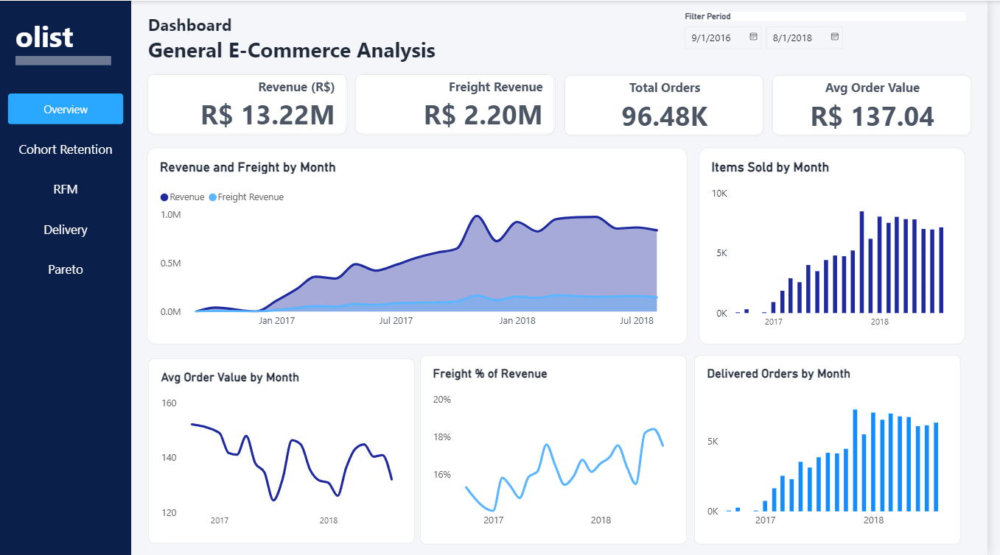
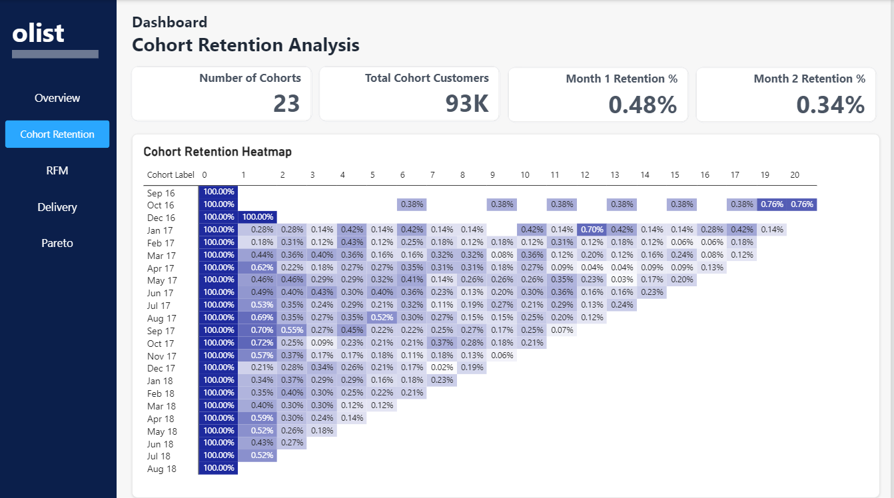
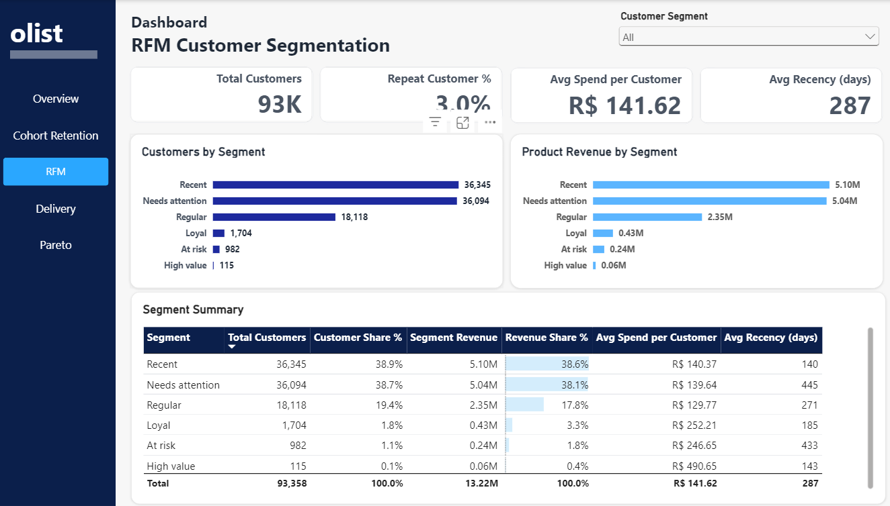
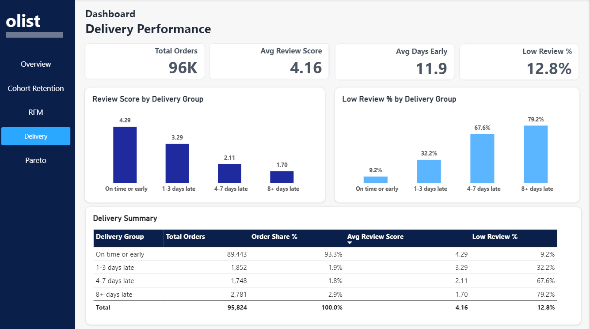
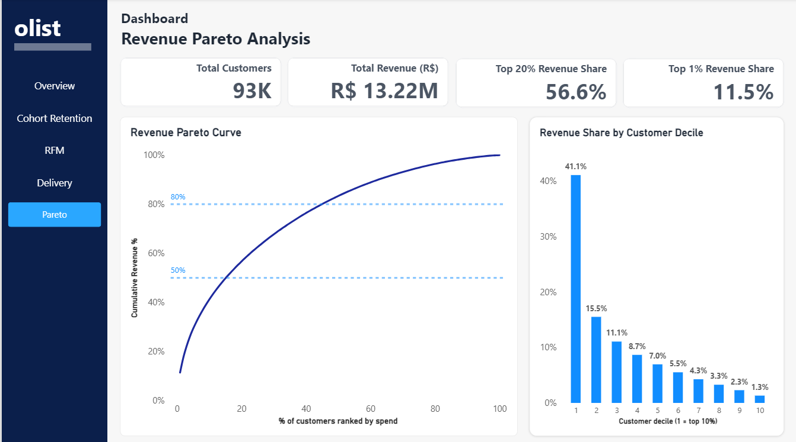

# Olist Brazilian E-commerce Analytics

An end-to-end analytics portfolio project using PostgreSQL, SQL, and Power BI on the Olist Brazilian E-Commerce Public Dataset. It explores sales performance, customer retention, RFM segments, customer revenue concentration, and the relationship between delivery delays and review scores.

## Dashboard





The Power BI report contains five pages:

1. **Overview** — delivered orders, product revenue, freight, weighted average order value, and monthly trends.
2. **Cohort Retention** — monthly repeat-customer activity by first delivered-order month, with Month 1 and Month 2 retention KPIs.
3. **RFM Customer Segmentation** — customer and product-revenue distributions by segment, with segment-level summary metrics.
4. **Delivery Performance** — review scores and low-review rates by delivery-delay group.
5. **Revenue Pareto Analysis** — cumulative customer revenue concentration and revenue share by customer decile.

The Power BI Desktop report is included at `powerbi/olist_ecommerce_report.pbix`. SQL result exports are used to load the report and are excluded from Git.

## Key findings

- The analysis includes **96,478 delivered orders**, with **R$13.22M** in product revenue and **R$2.20M** in freight value. Product revenue is item price; freight is reported separately.
- November 2017 is the peak delivered-order purchase month, at **R$987,765.37** in product revenue.
- The cohort analysis contains **23 customer cohorts**. Month 0 is 100% by definition; later monthly retention is low, reflecting the small number of repeat buyers.
- The corrected RFM output includes **93,358 customers**. **3.0%** have more than one delivered order. Segment labels are working rules defined in SQL.
- The top **10%** of customers account for **41.10%** of product revenue; the top **20%** account for **56.62%**.
- Average review scores decline across later-delivery groups, from **4.29** for on-time or early orders to **1.70** for orders at least eight days late. This is an association in the observed data, not proof of causation.

See [metric definitions](docs/metric_definitions.md) and [detailed findings](docs/insights.md) for scope and caveats.

## Tools

- PostgreSQL 18 (SQL is written for PostgreSQL)
- pgAdmin 4 or `psql` for loading and querying
- Power BI Desktop for the report

## Dataset

Download the **Brazilian E-Commerce Public Dataset by Olist** from [Kaggle](https://www.kaggle.com/datasets/olistbr/brazilian-ecommerce). Extract the eight source CSVs into `data/raw/` using their original filenames. The source data covers orders from 2016 to 2018.

Do not commit the raw dataset or exported CSV results. They are excluded by `.gitignore`; download or generate them locally when reproducing the project.

## Reproduce the analysis

### 1. Create and load the raw tables

From the project root, the included `psql` script creates a new database named `olist_analysis`, creates the `olist_raw` schema, imports the CSVs, and runs validation:

```bash
psql -h localhost -p 5432 -U postgres -d postgres -W -f sql/03_create_and_load.psql
```

Replace `postgres` with your PostgreSQL username if needed. The command prompts for the password; no credentials are stored in this repository. The script creates a new database, so use it only when `olist_analysis` does not already exist.

If loading manually in pgAdmin, run `sql/01_create_schema.sql`, import each CSV into its matching `olist_raw` table, then run `sql/02_validate_data.sql`. Use pgAdmin's Import/Export Data workflow for CSVs; `psql` meta-commands such as `\copy` are not SQL statements for the Query Tool.

### 2. Run the analysis queries

Run each script in pgAdmin's Query Tool or `psql`:

| Script | Output |
|---|---|
| `sql/03_monthly_sales.sql` | Monthly delivered orders, product revenue, freight, order value, and items sold |
| `sql/04_cohort_retention.sql` | Customer retention by first delivered-order month and months since first order |
| `sql/05_rfm_segmentation.sql` | Customer-level recency, frequency, monetary values, scores, and segments |
| `sql/06_revenue_pareto.sql` | Customer-level cumulative revenue concentration |
| `sql/07_delivery_review_analysis.sql` | Review metrics grouped by delivery-delay band |

Export each result set as a CSV with its header row. Save locally in `powerbi/exports/` using the filenames below. The export folder is ignored by Git.

- `monthly_sales.csv`
- `cohort_retention.csv`
- `rfm_segments.csv` — use the corrected SQL in this repository
- `revenue_pareto.csv`
- `delivery_review.csv`

### 3. Build or refresh the Power BI report

In Power BI Desktop, use **Home → Get data → Text/CSV** to load the five exports. Follow [the Power BI build guide](powerbi/build_guide.md) for data types, measures, report layout, and interpretation notes. Save the report to `powerbi/olist_ecommerce_report.pbix`.

## Repository structure

```text
sql/                 Schema, validation, loading script, and five analysis queries
docs/                Metric definitions and findings
powerbi/             Power BI build guide, DAX measures, report, and local export location
data/raw/            Downloaded source CSVs (ignored by Git)
work/                Local logs and temporary files (ignored by Git)
```

## Data handling and analytical caveats

- `order_items` and `order_payments` can have multiple rows per order. The queries aggregate to order grain before joining to prevent duplicated metrics.
- Product revenue is based on item prices and excludes freight. Order value is product revenue divided by delivered orders.
- Cohort SQL is sparse: it returns cohort/month combinations with activity. Blank matrix cells may mean zero observed returns or future periods outside the data window.
- Delivery comparisons use **95,824** delivered orders with the required review and delivery dates. **654** delivered orders are excluded because a required review or date is missing.
- Delivery delay and review score are observational; the analysis does not establish that delays caused lower reviews.
- RFM segments are heuristic business labels based on the scoring rules in `sql/05_rfm_segmentation.sql`, not an externally validated taxonomy.


